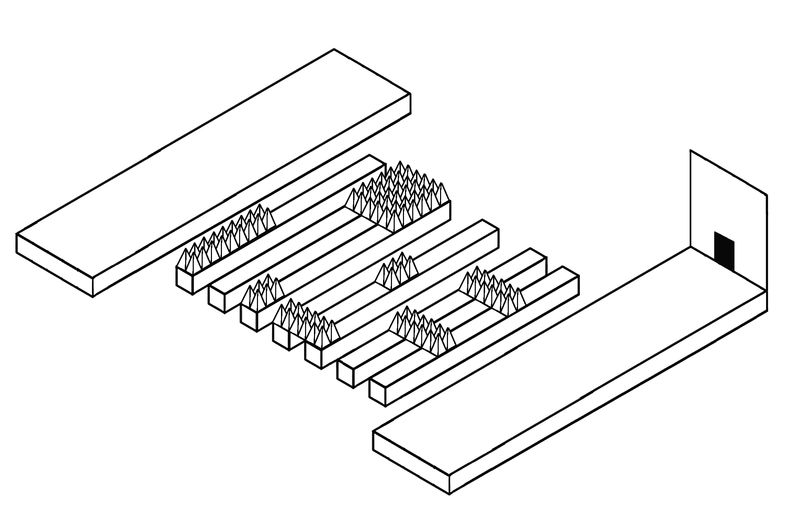
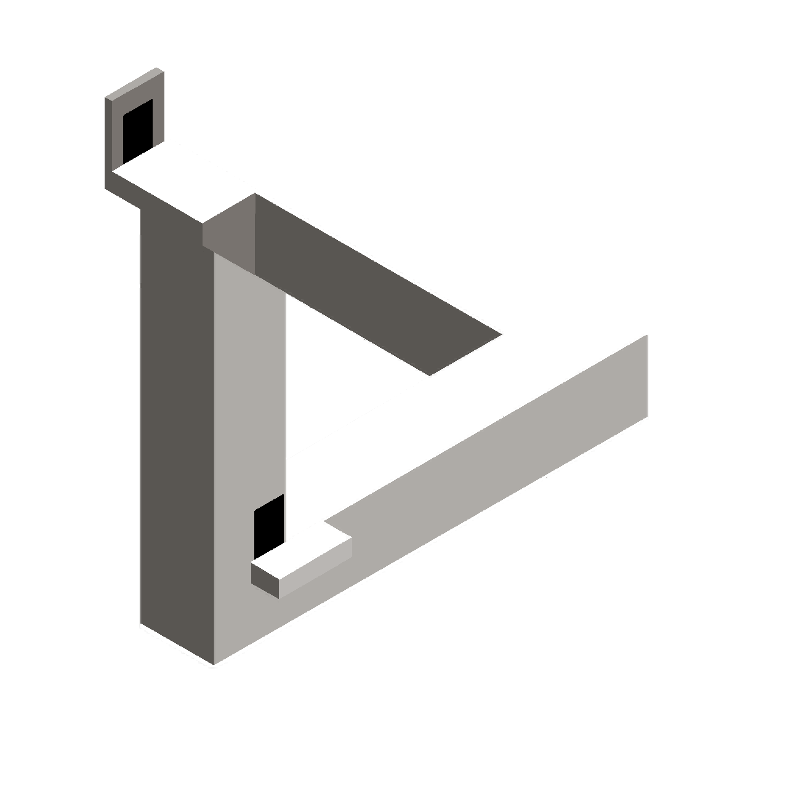
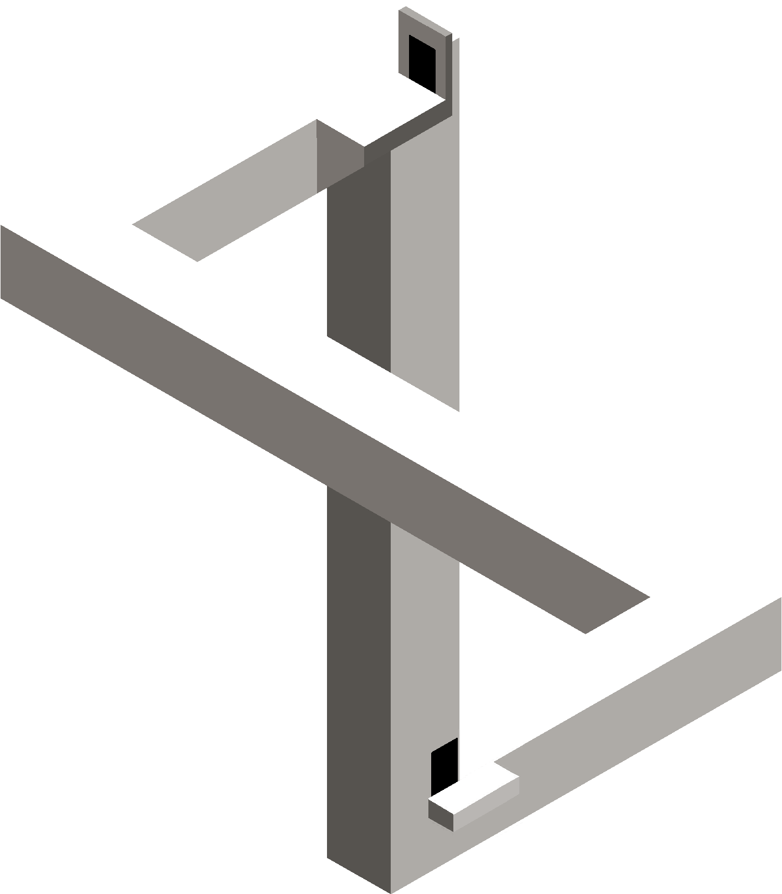

# Aberrant Illusions

**A perspective-based platformer combining 3D movement with optical-illusion level artwork.**

Unity · C# · Acerola Jam 0

**[Play in your browser on itch.io](https://ahmetbilgi.itch.io/aberrant-illusions)**

## Overview

Guide a hooded fox through a 3.5D world to reach a lost ruby. Orthographic camera framing and illusion-based platform artwork challenge the player's perception of depth and space.

This repository is a compact **code showcase**. It highlights the project's movement, progression and interactive systems, with a small selection of level artwork. Play the published game using the itch.io link above.

## Project highlights

- **3D character movement:** Rigidbody-based acceleration, deceleration, speed limits and smooth rotation toward movement.
- **Responsive jumping:** raycast ground detection, jump buffering and coyote time.
- **Checkpoints and respawning:** an in-memory checkpoint position, animated checkpoint feedback and a persistent game manager.
- **Scene progression:** door interactions, a temporary player stand-in, timed screen transitions and next-scene loading.
- **Barrel hazards:** timed spawning, waypoint-based motion, rotation and a variant that limits repeated spawns of the same barrel type.
- **Presentation:** animation parameters, footsteps/jump audio hooks, scaling/movement effects and a shadow-following helper.

## Code worth exploring

| System | Source | What to look for |
| --- | --- | --- |
| Character controller | [PlayerScript.cs](Player_and_Feedback/PlayerScript.cs) | Rigidbody movement, buffered jumping, coyote time, animation and facing direction |
| Checkpoint feedback | [CheckpointTrigger.cs](Level_Progression/CheckpointTrigger.cs) | Save position, change material, play animation and audio |
| Progression manager | [GameMaster.cs](Level_Progression/GameMaster.cs) | Singleton lifetime, checkpoint state and transition coroutine |
| Door interaction | [DoorToNextScene.cs](Level_Progression/DoorToNextScene.cs), [SmoothMover.cs](Gameplay_and_Effects/SmoothMover.cs) | Player stand-in movement and delayed scene changes |
| Barrel spawning | [BarrelDispenserV2.cs](Gameplay_and_Effects/BarrelDispenserV2.cs) | Spawn timing variation and a cap on consecutive identical barrel types |
| Barrel movement | [BarrelMove.cs](Gameplay_and_Effects/BarrelMove.cs) | Coroutine-based waypoint motion and rotation |
| Collapsing stairs | [Stairs.cs](Gameplay_and_Effects/Stairs.cs) | Trigger-driven scaling and removal |
| Player shadow | [Test.cs](Player_and_Feedback/Test.cs) | Follow player position and vary sprite scale/alpha with height |

## Level-art previews

These are **source level-art images**, not captured gameplay screenshots. They show the visual layouts used to explore platforming and depth illusions; character models, runtime colliders and scene composition are not shown.

| Impossible triangle | Interlocking forms |
| --- | --- |
|  |  |

## Controls

From the included [input action asset](Player_and_Feedback/PlayerInputs.inputactions):

| Action | Keyboard |
| --- | --- |
| Move | WASD or arrow keys |
| Jump | Space |

These bindings were inspected in the source and have not been retested against the published build.

## Repository layout

- `Player_and_Feedback/`: player controller, death handling, shadow/follow helpers and input bindings.
- `Level_Progression/`: checkpoint state, scene management, doors and end-goal behaviour.
- `Gameplay_and_Effects/`: barrel interactions, waypoint motion and presentation effects.
- `images/`: three source level-art previews.

All **19 supplied project C# scripts** are retained without changes. Generic names such as `Test.cs` are preserved because these scripts contain actual shadow/follow behaviour. Some scripts are alternative implementations; the showcase does not claim that every supplied script was active in the final build.

## Scope

This is **not a runnable Unity project**. Scenes, models, bulk artwork, textures, materials, animations, prefabs, fonts, audio and Unity `.meta` files are intentionally omitted to keep the repository focused. The original archive contained scene assets, but no package manifests or ProjectSettings were supplied. The original Unity/package versions and scene build order are not established here.

The code relies on Unity's 3D physics, animation, scene management and Input System, along with configured scene references, tags and layers. The illusions are part of the visual/level setup; they are not presented as a standalone illusion algorithm implemented by these scripts. Compilation and gameplay have not been tested for this extracted showcase.

## Credits

Project by **Ahmet Bilginoğlu** ([GitHub](https://github.com/ahmetbilginogluu) · [itch.io](https://ahmetbilgi.itch.io/)). The original game combines custom and third-party material. See [CREDITS.md](CREDITS.md) for the scope of the included previews and excluded assets.
